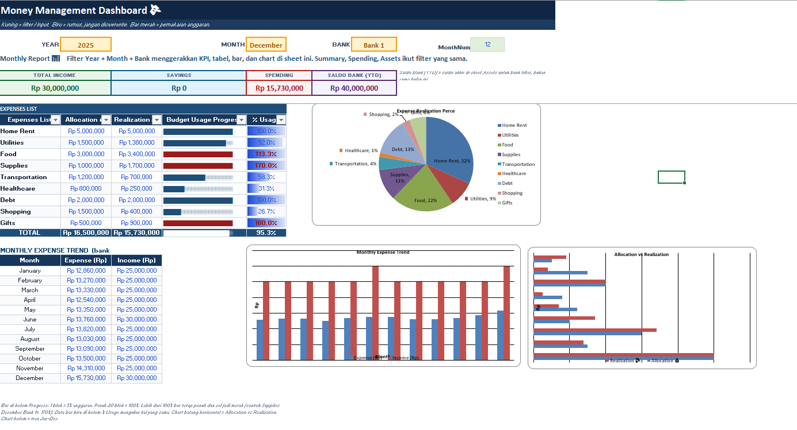
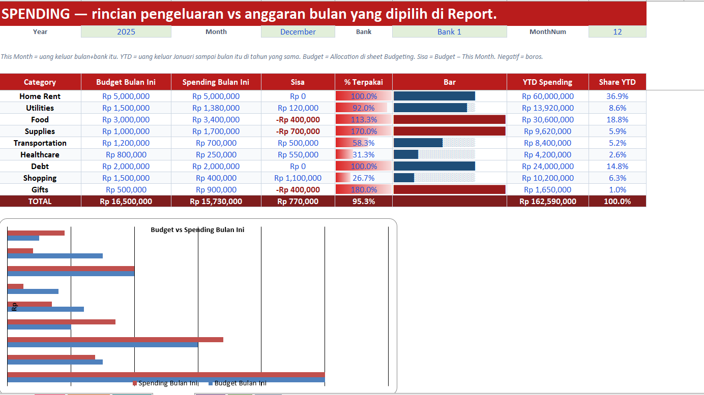

# 💰 Excel Money Management Dashboard Generator

**Automated Personal Finance Dashboard Builder** — Generate a comprehensive Excel-based money management system with Python.


---

## 📊 Overview

A Python script that **programmatically generates** a fully-functional Excel dashboard for personal finance tracking. No manual cell formatting, no copy-paste formulas — everything is built through code using `openpyxl`.

**Perfect for:**
- Individuals tracking monthly income/expenses across multiple bank accounts
- Couples managing shared finances
- Anyone who wants a ready-to-use budgeting template
- Developers learning Excel automation with Python

---

## ✨ Features

### 7 Interconnected Sheets

1. **REPORT** — Main dashboard with KPIs, charts, and expense tracking
   - Dynamic filters (Year/Month/Bank)
   - Real-time KPIs: Total Income, Savings, Spending, Bank Balance
   - Visual progress bars for budget usage
   - Pie chart (expense breakdown) + bar charts (trends)

2. **DATA** — Transaction log (raw input)
   - 332 pre-filled dummy transactions (Income + Expenses)
   - Dropdown validation (Bank, Category, Type)
   - Auto-calculated year/month fields

3. **BUDGETING** — Monthly budget targets
   - 9 expense categories (Rent, Food, Transportation, etc.)
   - Customizable allocation per category per month
   - Direct link to REPORT for variance analysis

4. **SUMMARY** — 12-month overview
   - Income vs Expense per month
   - Savings calculation with status indicator (Surplus/Deficit)
   - Year-to-date totals

5. **SPENDING** — Detailed monthly expense analysis
   - Budget vs Actual comparison
   - Visual progress bars (20-block █░ representation)
   - Conditional formatting (red when over-budget)
   - YTD spending and share percentages

6. **ASSETS** — Account balances
   - 3 bank accounts + Cash + Emergency Fund + Investments
   - Auto-calculated ending balance (Opening + Income - Expense)
   - Pie chart for asset composition

7. **SETUP** — Master data lists (hidden)
   - Years, Months, Banks, Categories
   - Named ranges for dropdown validation

---

## 🛠️ Tech Stack

- **Python 3.8+**
- **openpyxl 3.1.0+** — Excel manipulation library

### Key Techniques Demonstrated

✅ **Dynamic formula generation** — All `SUMIFS`, `MATCH`, `INDEX` formulas built programmatically  
✅ **Conditional formatting** — Data bars, cell color rules, icon sets  
✅ **Chart creation** — Pie charts, bar charts, column charts with custom styling  
✅ **Data validation** — Dropdown lists linked to named ranges  
✅ **Named ranges** — `YearList`, `MonthList`, `BankList`, `CatList` for reusable references  
✅ **Cell styling** — Fonts, fills, borders, alignment with color-coded sections  
✅ **Sheet protection patterns** — Yellow cells (input), blue cells (formulas), visual cues  

---

## 🚀 Quick Start

### Installation

```bash
# Clone the repository
git clone https://github.com/YOUR_USERNAME/excel-money-management.git
cd excel-money-management

# Install dependencies
pip install -r requirements.txt
```

### Usage

```bash
# Generate the Excel file
python money_management.py
```

**Output:** `Money_Management_Dashboard.xlsx` (ready to use)

### Customize

Open the generated Excel file and:
1. **REPORT** sheet → Change Year/Month/Bank filters (dropdown cells)
2. **DATA** sheet → Add your own transactions (yellow input columns)
3. **BUDGETING** sheet → Adjust monthly budget allocations
4. **ASSETS** sheet → Update opening balances for your accounts

All charts and KPIs **update automatically** via formulas.

---

## 📸 Screenshots

### Main Dashboard (REPORT Sheet)

*KPI cards, expense breakdown, budget usage bars, and monthly trends*

### Budget vs Actual (SPENDING Sheet)

*Conditional formatting highlights over-budget categories in red*

---

## 🎯 Use Cases

### Personal Finance Tracking
- Track expenses across multiple bank accounts
- Monitor budget adherence in real-time
- Visualize spending patterns month-over-month

### Learning Resource
- Study advanced `openpyxl` techniques
- Understand Excel formula automation
- Learn conditional formatting via Python

### Template Base
- Modify for business expense tracking
- Adapt for project budgeting
- Extend with additional categories/accounts

---

## 🔧 Code Highlights

### Dynamic Formula Generation
```python
# Summary sheet income calculation
sm.cell(row=r, column=3, value=(
    f'=SUMIFS(Data!E:E,Data!F:F,"Income",Data!B:B,$E$2,Data!G:G,$B$2,Data!H:H,B{r})'
))
```

### Conditional Formatting with Data Bars
```python
# Red data bar for budget usage percentage
sp.conditional_formatting.add("E6:E14", DataBarRule(
    start_type="num", start_value=0, 
    end_type="num", end_value=1,
    color="DC2626", showValue=True
))
```

### Named Range Setup
```python
wb.defined_names.add(
    DefinedName(name="BankList", attr_text="Setup!$C$4:$C$6")
)
```

### Visual Progress Bar (Text-Based)
```python
# 20-block bar (█ = filled, ░ = empty)
sp.cell(row=r, column=6, value=(
    f'=REPT("█",MIN(20,ROUND(E{r}*20,0)))'
    f'&REPT("░",MAX(0,20-MIN(20,ROUND(E{r}*20,0))))'
))
```

---

## 📂 File Structure

```
excel-money-management/
├── money_management.py       # Main generator script
├── requirements.txt          # Python dependencies
├── README.md                 # This file
├── .gitignore               # Git exclusions
└── screenshots/             # Dashboard previews (optional)
    ├── dashboard_preview.png
    └── spending_preview.png
```

---

## 🧮 Dummy Data Included

Pre-filled with realistic test data:
- **Income:** Monthly salary (3 banks) + bi-annual bonuses
- **Expenses:** 9 categories × 12 months × 3 banks = 324 transactions
- **Budgets:** Default allocations for each expense category
- **Opening balances:** Bank 1 (Rp 40M), Bank 2 (Rp 22M), Bank 3 (Rp 8.5M)

Amounts in **Indonesian Rupiah (Rp)** but easily adaptable to any currency.

---

## 🤝 Contributing

Suggestions and improvements welcome! Potential enhancements:
- CSV import for bank transactions
- Multi-currency support
- Investment portfolio tracking
- Recurring transaction automation
- Mobile-friendly Google Sheets version

---

## 📝 License

MIT License — Free to use, modify, and distribute.

---

## 👨‍💻 Author

Built to showcase **Python + Excel automation** for portfolio purposes.

**Skills demonstrated:**
- Clean, readable Python code
- Advanced spreadsheet programming
- Financial modeling concepts
- UX design (color coding, visual hierarchy)

---

## 🔗 Links

- [openpyxl Documentation](https://openpyxl.readthedocs.io/)
- [Excel Formula Reference](https://support.microsoft.com/en-us/excel)

---

**⭐ If you find this useful, consider starring the repo!**
